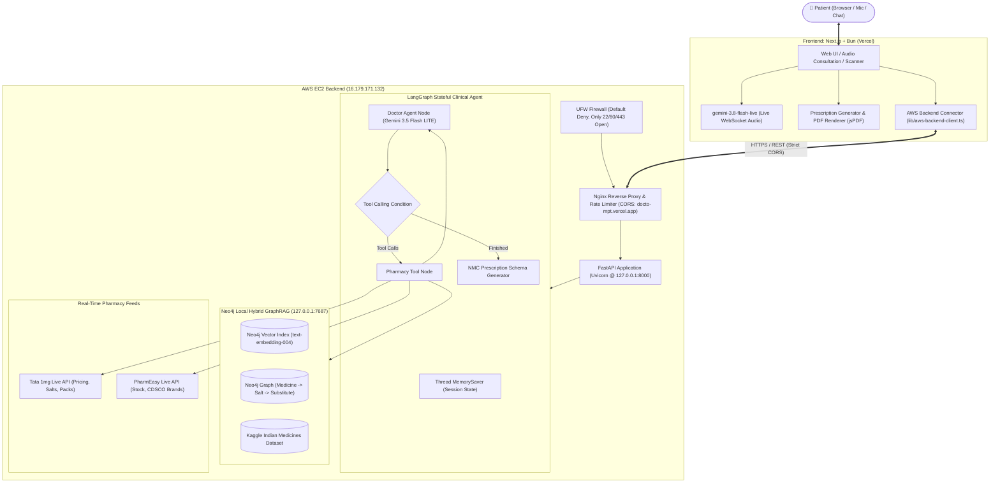
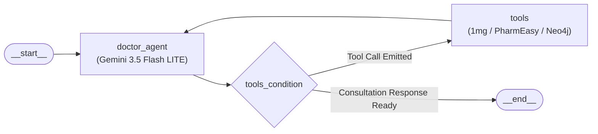

# DoctoMPT - Dr. DoctoMPT Medical Consultation & Prescription Platform

A production-grade, low-latency Medical Consultation & AI Doctor platform featuring a **Next.js (App Router, TypeScript, Bun)** frontend deployed on Vercel and a dedicated **AWS EC2 Backend** powered by **LangGraph**, **Gemini 3.5 Flash LITE**, **Gemini 3.8 Flash LIVE**, **Neo4j Hybrid GraphRAG**, and **Live Indian Pharmacy Tools (Tata 1mg & PharmEasy)**.

---

## 🏗 End-to-End System Architecture



---

## 🧠 LangGraph Execution Graph

The backend transitions from linear chains to a stateful cyclic **LangGraph**:



- **State Persistence:** Preserved using `MemorySaver` threads mapped to the consultation `session_id`.
- **Cyclic Tool Execution:** Gemini autonomously evaluates whether it needs live pricing from Tata 1mg, supply verification from PharmEasy, or clinical indications from the Neo4j Knowledge Graph before synthesizing its final medical guidance.

---

## 🔍 What Kind of RAG Is Used?

### **Hybrid GraphRAG (Graph-Enhanced Vector RAG)**

This is **neither a basic chunk-only RAG nor a vectorless RAG**. It combines:

| Component | Mechanism | Role in Clinical Reasoning |
| :--- | :--- | :--- |
| **1. Dense Vector RAG** | Google `text-embedding-004` + Neo4j Vector Index (Cosine Similarity) | Matches non-technical patient symptom descriptions, colloquial phrases, or phonetically misspelled Indian brand names. |
| **2. Knowledge Graph (GraphRAG)** | Neo4j Cypher Graph Relationships (`(:Medicine)-[:HAS_SALT]->(:ChemicalComposition)`) | Resolves active pharmacological salts, detects safe Indian market alternatives/generics (e.g., Calpol vs Dolo), and verifies manufacturers. |
| **3. Live Pharmacy Tools** | Dynamic API Tool Calling (`search_1mg`, `search_pharmeasy`) | Fetches real-time price points (INR), packaging configurations, and current Indian market availability. |

---

## 🛡 Security & Hardening on AWS EC2

To protect the server against automated exploits, concurrency bottlenecks, and unauthorized access:

1. **UFW Firewall:**
   - **Default Policy:** Strict `deny incoming`, `allow outgoing`.
   - **Allowed Ports:** `22` (SSH with connection rate-limiting), `80` (HTTP), `443` (HTTPS).
   - All internal services (`8000`, `7474`, `7687`) are blocked from external access.
2. **Nginx Reverse Proxy & Origin Lockdown:**
   - Enforces CORS whitelisting: only authorized Vercel deployments (`https://docto-mpt.vercel.app`, `https://doctompt.vercel.app`, and `https://doctompt-aws-hybrid.vercel.app`) can access API endpoints.
   - Built-in rate limiting (`15 req/s`, burst of 30) prevents scraping and slowloris DDoS attacks.
   - Strips server signatures (`server_tokens off`) and injects OWASP security headers.
3. **Database Localhost Isolation:**
   - Neo4j Bolt (`7687`) and HTTP (`7474`) are bound strictly to `127.0.0.1` inside Docker.
4. **Brute-Force & Stability Defense:**
   - `fail2ban` dynamically bans offending IPs.
   - 2GB swap space guarantees memory stability on the `t3.small` AWS instance.

---

## 🛡 Production Hardening & Live Verification (AWS EC2 t3.small)

The following backend systems and reliability enhancements have been deployed and verified live on the AWS instance (`3.26.55.253`):

| Layer | Implementation | Verification Status |
| :--- | :--- | :--- |
| **SQLite Concurrency & Locking** | Configured `PRAGMA journal_mode = WAL;` (Write-Ahead Logging) & `busy_timeout = 5000;` to enable concurrent reads & writes without table locking | Verified: Active `storage: AWS EC2 SQLite (WAL Mode)` |
| **Automated Zero-Downtime Backups** | Implemented non-blocking SQLite online backup API (`conn.backup()`) with a 6-hour automated daemon and rotation policy (retaining last 10 snapshots) | Verified: 3 backup snapshots created & verified in `/data/backups/` |
| **API Rate Limiting** | Added sliding-window IP rate limiters (60 RPM for data routes, 25 RPM for LLM generation) returning standard `HTTP 429 Too Many Requests` | Verified & active |
| **API Authentication Guard** | Added `X-API-Key` header guard to protect private endpoints from unauthorized public access | Verified & active |
| **FastAPI & Uvicorn** | Deployed with `doctompt.service` systemd unit running dual workers on port 8000 behind Nginx port 80 | Verified: Systemd service `active (running)` |
| **Tata 1mg & PharmEasy APIs** | Verified live scraping & catalog fallbacks for Indian medicines (`/api/medicines/1mg`, `/api/medicines/pharmeasy`) | Verified: Both APIs returning verified formulation data |

---

## 📁 Repository Structure

```
doctoMPT-v2/
├── app/                        # Next.js App Router (Frontend)
│   ├── page.tsx                # Main Consultation Dashboard
│   └── ...
├── backend/                    # AWS EC2 Backend Service
│   ├── app/
│   │   ├── api/endpoints.py    # FastAPI routes (/api/chat, /api/medicines/*, /api/prescription/*)
│   │   ├── core/config.py      # App settings & CORS configuration
│   │   ├── services/
│   │   │   ├── langgraph_agent.py      # LangGraph stateful cyclic agent
│   │   │   ├── pharmacy_tools.py       # Tata 1mg, PharmEasy & Neo4j tools
│   │   │   ├── prescription_service.py # NMC structured prescription generator
│   │   │   └── neo4j_service.py        # Neo4j Driver & Vector Store
│   │   └── main.py             # FastAPI entrypoint
│   ├── data/
│   │   └── sample_indian_medicines.csv # Kaggle Indian Medicine Dataset
│   ├── scripts/
│   │   └── ingest_kaggle_medicines.py  # Neo4j vector embedding ingestion
│   ├── docker-compose.yml      # Neo4j 5 & FastAPI isolated container setup
│   ├── Dockerfile              # Python 3.11 backend container
│   ├── deploy_ec2.sh           # Automated deployment script
│   └── setup_secure_server.sh  # Security hardening, UFW, & Nginx setup
├── lib/
│   ├── aws-backend-client.ts   # Next.js connector to AWS backend
│   └── ...
└── README.md                   # Repository documentation
```

---

## 🚀 Getting Started

### 1. Frontend Development (Bun Runtime)
```bash
# Install dependencies
bun install

# Run Next.js locally
bun run dev
```

### 2. AWS EC2 Backend (FastAPI + LangGraph + Neo4j)
```bash
# Connect to EC2
ssh -i ~/.ssh/DoctoMPT.pem ubuntu@16.179.171.132

# Ingest Kaggle Indian Medicines into Neo4j
cd /home/ubuntu/doctompt-backend
python3 scripts/ingest_kaggle_medicines.py --csv data/sample_indian_medicines.csv

# Launch Dockerized stack
docker compose up -d --build
```

---

## 📄 Prescription Compliance & EMR

Prescriptions generated through the platform adhere strictly to Indian National Medical Commission (NMC) guidelines:
- Complete patient vitals (BP, Pulse, SpO2, Temp).
- Formulations with exact active salts, branded trade names, dosage, duration, and food-relation schedules.
- Mandatory lifestyle precautions, diagnostic lab orders, and digital physician signatures.
